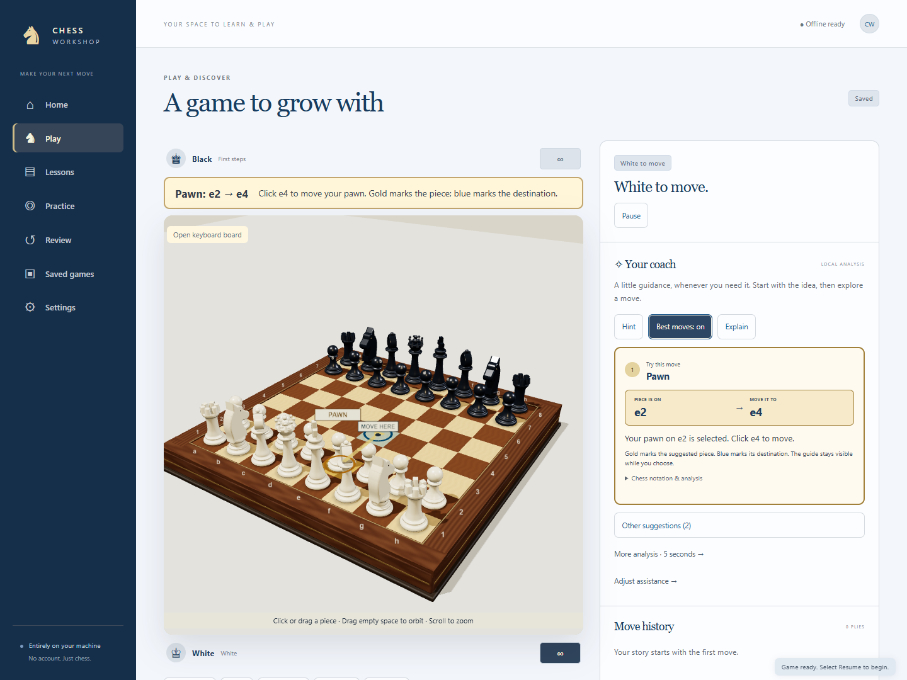
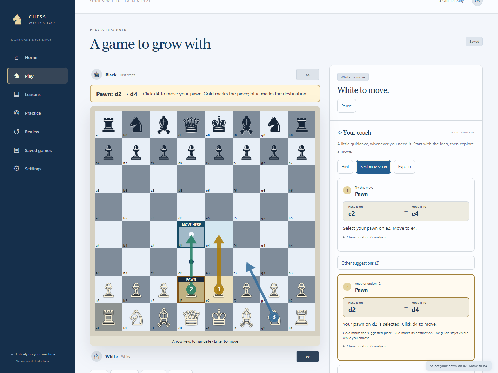
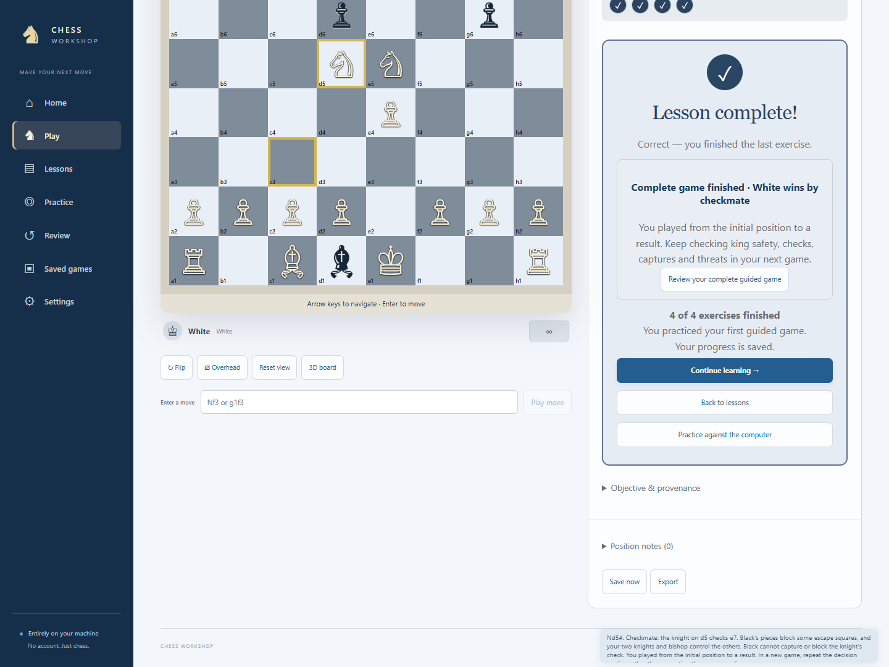

# Chess Workshop

A local, offline chess learning application for Windows. Final verification uses Chrome; Edge passed core journeys during development. Firefox compatibility is unverified on this machine. Real procedural 3D pieces and a wooden board share legal rules and saved state with a keyboard-accessible flat board. No accounts, remote opponents, analytics, remote fonts, or runtime downloads.

Implementation and verification are complete for this release. All A1–A16 acceptance scenarios pass, including 95 unit tests and 106 Chrome journeys. The user accepts the lessons for now and has accepted the gentler Beginner introduced in teaching policy 2. No measured human rating or learning outcome is claimed. The blocked-pawn timeout regression now enters a visible, saved adjudication state instead of assigning a winner from material alone. The [completion audit](docs/COMPLETION-AUDIT.md) records evidence and limits without treating automated legal replay as human learning validation.

Beginner now sometimes chooses a quiet move instead of taking a free piece or calculating a threat. First steps does this more often. Both always obey the rules, and the coach still analyzes at full strength. Existing games use the revised opponent on future computer turns after reloading; all played moves remain unchanged.

## Install and run locally

### Windows offline package

The prebuilt ZIP accompanies this delivery. To produce it from a source checkout on Windows, run `npm run package` after building.

1. Extract `ChessWorkshop-1.0.0-Windows.zip` into a normal folder.
2. Double-click **Launch Chess Workshop.cmd**. The package includes Node.js; npm and internet access are not needed to play.
3. Open **http://127.0.0.1:4173** in Chrome if a browser does not open automatically.
4. Keep the server window open. Close it or press **Ctrl+C** to stop the local server.

Use the same address and browser profile to keep your saves. If port 4173 is occupied, close the previous launcher or the application using it. The launcher deliberately refuses to select another port because browser saves belong to an origin. This loopback server runs on your PC; a Windows background-service installation is not required.

### From source

Install Git and Node.js with npm. The pinned Vite build supports Node **20.19+ or 22.12+**; this build was verified using Node **20.19.4**. Internet access is needed for the initial dependency installation.

```powershell
git clone https://github.com/jhoyos135/ChessWorkshop.git
cd ChessWorkshop
npm ci
node scripts/bundle-engine.mjs
npm run build
npm start
```

Open **http://127.0.0.1:4173** in Chrome. After building, normal play, lessons, coaching and saves run entirely locally. Keep the terminal open while using the application; press **Ctrl+C** to stop it.

If Git on Windows reports an issuer-certificate error when cloning, use the Windows trusted certificate store for that command:

```powershell
git -c http.sslBackend=schannel clone https://github.com/jhoyos135/ChessWorkshop.git
```

This keeps TLS certificate verification enabled. It does not affect the offline launcher.

For development, use `npm run dev` instead of `npm start`. Both use the same strict loopback origin, so run only one server at a time. After source changes, rebuild with `npm run build` before using the production launcher. Refresh the browser to load a new production build.

```powershell
npm test
npm run validate:content
npm run test:browser
npm run package
```

Browser tests use installed Chrome. Packaging on Windows bundles the local Node runtime, production assets, source, engine provenance, licenses and a SHA-256 manifest. Generated packages, dependencies, build output and temporary browser reports are excluded from Git.

## Screenshots

The 3D board has sculpted pieces, optional coaching and named source markers.



The accessible flat board shows the same legal position and recommendations.



The guided-game lesson finishes at actual checkmate and saves its completion.



## Play and learn

Home offers computer play, local two-player play, 32 lessons with 97 exercises, practice, review, and your library. New learners can select **Start from zero**. **I know the moves** opens the optional knight placement exercise; all lessons stay available.

The interface uses navy navigation, blue buttons and highlights, and a slate-blue flat board. The 3D set retains its wooden board and ivory/ebony pieces. High contrast strengthens square labels and piece visibility, and text can scale to 200% in Settings.

Computer setup offers six levels and either color. First steps and Beginner use a deterministic teaching policy in a local background worker; higher levels use Stockfish skill 2, 6, 12, and 20. These are training presets, not human ratings. The coach always searches at full available strength. Select **Resume** to start or restart a session. Untimed games are the default.

Click a piece and then its destination, drag a piece, or use the move-entry field with SAN (`Nf3`) or UCI (`g1f3`). With **Legal destinations** enabled for the side to move, pressing/selecting a piece immediately shows its legal moves: dots for empty squares and rings for captures. A dragged piece lifts and follows the pointer; releasing commits a legal move, while an illegal drop returns it smoothly to its square. A **DROP HERE** marker shows the accepted square during a drag; **NOT LEGAL** marks an invalid target. Perspective drops also recognize a piece whose base is clearly centered on a legal square, so camera lock does not prevent moving pieces. Turn the feature on or off under **Adjust assistance → Legal destinations**, independently for White and Black. Promotion opens a chooser for queen, rook, bishop, or knight. Camera orbit starts by dragging empty space; use the wheel to zoom. Select **Lock camera** below the 3D board to freeze orbit and wheel zoom while continuing to select and drag pieces. **Camera locked** confirms the setting, which survives save/reload. Click again to unlock. The Home preview stays unlocked, and a new game starts unlocked. Deliberate Flip, Overhead and Reset view controls still work while locked. Flip, overhead, reset, and flat-board controls are below the board. Camera gestures never change the rules position.

For keyboard play, open the flat board or **Open keyboard board** in the 3D view. Arrow keys move focus; Enter selects a piece or destination; Escape clears selection. You can also type every move in the labeled move-entry field. Status announcements, text recommendations, visible focus, scalable text, reduced motion, high contrast, and optional synthesized sound are available. No task requires sound.

Local two-player setup allows names, fixed or flipping orientation, and help for White only, Black only, both, or neither. Hints, arrows, and explanations are independently Off, On request, or Automatic for each side. Help is visible to both players. A flip requires a **Continue** handoff; changing assistance and taking back a move require acknowledgments through shared controls. Undo preserves the previous continuation. Computer undo returns to the learner’s previous decision, including the reply when already played.

## Coaching, lessons, practice, and review

Guided assistance supplies automatic help and factual explanations of played moves; Coached supplies requested help and important-mistake feedback; Independent begins without automatic recommendations and still allows requested help. **After your moves** independently selects Off, Mistakes, or Every move for each player. Older saves without that setting keep it Off until changed. Previous-move comparisons use the full-strength coach, separate from opponent difficulty. They identify the earlier decision, keep mate scores separate from pawn differences, offer a hidden-answer retry, and save into the review history. Requested current-position help takes priority over background checks. In shared play, previous-move feedback waits for that player’s next turn. Legal destinations, threats, evaluation, and mistake protection are separate switches. Progressive hints start with an idea, highlight a useful piece with **HINT PIECE**, then reveal a move and continuation. The piece highlight works even when recommendation arrows are Off. Reveals are recorded as assisted practice. One recommendation is emphasized first; expand Other suggestions to compare up to three numbered arrows and matching candidates. A “best move” is the strongest move found within a local budget. Scores favor White when positive; mate estimates stay separate. More analysis searches for five seconds. Explanations describe verified observations, never an invented guarantee.

**Show best moves** is a toggle. Click once to keep recommendations on for that side’s future turns; **Best moves: on** confirms the state. Click again to switch off automatic recommendations. The choice survives save/reload; resume the game to restart analysis. The coach shows a first result promptly, then checks the unchanged turn more deeply with a three-second search. **Checking more deeply…** identifies that background work. A move or pause cancels it immediately. The primary recommendation matches Stockfish’s final move for the analyzed position; incomplete newer output is never replaced by a different older primary. If only that line is verified, fewer alternatives are shown. Across the table has separate **White best moves: on/off** and **Black best moves: on/off** toggles. You can change either player’s saved choice; suggestions appear only on that player’s turn. Both players acknowledge each change, including enabling the display from an Off profile. Changing White’s toggle does not change Black’s, or vice versa.

**Explain** is also a saved toggle. **Explain: on** keeps explanations on for that player’s future turns; click again to turn them off. It works independently of recommendation arrows. In shared play the change is acknowledged by both players and edits only the current player’s explanation setting. The **Why this move helps** section names the relevant board benefit, shows one calculated reply, and highlights an immediate recapture or a worse-scoring alternative when supported. It covers development, central squares, opened lines, king safety, checks, pins, passed pawns, promotion and material changes in a replayed example. Scores are estimates; an attacked piece is not automatically a won piece.

With best moves on, the top suggestion automatically selects its source piece and marks its destination. The actual piece name (for example, **KNIGHT**) and **MOVE HERE** markers, a highlighted destination, and a sentence above the board explain the route. The card labels **PIECE IS ON** and **MOVE IT TO** spell out the piece and squares, such as **knight · g1 → f3**. The route stays visible when you click the source again, another piece, or an empty square. Expand **Other suggestions** and click a route to preview an alternative; this does not play it. Click the destination or drag the piece there to commit the move. Chess notation, evaluation, and the longer continuation are available under **Chess notation & analysis**.

Lessons follow **Learn the idea → Watch an example → Try it yourself**. Short instructions, contextual definitions, and movement diagrams introduce one idea. Demonstrations play one move at a time, with Pause and manual stepping. Teaching opens in a clear flat-board view; you can switch it to 3D. Most lessons have three playable exercises; Your first guided game has four, including a complete game. Progress counts follow the actual lesson. A successful exercise says **Correct!**; an intermediate move says **Correct so far**. An incorrect legal answer explains what the piece did, a missed target or an available reply, then repeats the goal and offers a reset. Capture cautions name legal replies without claiming they are forced. Teaching uses Retry and Practice again to reset exercises; game Undo and Resume controls are omitted from lessons. Finishing every required exercise automatically shows **Lesson complete!**, a save confirmation, and **Continue learning**. Progress, hints, and view choice survive reopening. An unfinished exercise resumes directly, and a paused demonstration can be played again. Earlier saves with all three exercises already solved are brought into the completion screen without awarding duplicate credit. Multi-move tasks use legal authored reply branches. Your first guided game adds a seven-decision, 13-ply game from the standard initial position to verified checkmate, with a checks–captures–threats routine and specific prompts at each turn. The opponent follows an authored Légal’s-mate pattern and can defend differently in an ordinary game. Mid-game resume restores the current decision. The completed game history stays attached to the lesson, can open as a separate review game, and survives JSON exchange. Older three-opening-decision completions retain their progress and continue into the new full-game exercise, including through the Home Continue learning control and portable backups. Lesson imports reject contradictory game results, clocks, history selections, and handoffs before changing the library. JSON, PGN, and FEN also reject a starting turn where the previous player left their king in check; a legal position with the current player in check remains importable. Mate tasks accept any legal checkmate and distinguish remaining legal replies, no check, and stalemate. Each of the 32 lessons can be browsed independently. Practice includes 100 original, locally bundled compositions: queen mate, rook mate, knight forks, and undefended queens. Provenance is shown in the task’s details. These compositions do not claim to be historical game positions.

Review analyzes a saved game locally in a cancellable queue. The short review displays up to five supported moments. **Every analyzed move** expands to played/suggested moves, separate evaluations, continuations, skill topics and provenance for every completed search. Analysis checkpoints survive cancellation and reload. Use **Reanalyze from start** after changing the search budget or threshold; older key-moment-only saves rebuild a full review. Select a game or **All mistake cards** to browse linked, answer-hidden retries and related lessons. Try **Retry · answer hidden** before revealing a continuation. A retry creates a separate saved session; the source game is preserved. Revealing a continuation or retry answer marks immediate retries as assisted, including after reload and reanalysis. A review at least a day later can count independently without further help. Reveals schedule an earlier revisit. Other equivalent moves are checked with compatible local searches. Use **Try a line** to explore a separate variation and save it without changing committed moves. Add notes to positions through game controls.

Completion is separate from independent practice. A skill needs three independent successes in at least two sessions, including a later review, before it is marked practiced independently. Initial review intervals are 1, 3, 7, and 14 days. A reveal or failure brings an earlier review. These are learning heuristics, not improvement or rating guarantees.

## Saves, backups, and recovery

Moves, clocks, lesson phases, attempts, hint stages, settings, and session changes autosave to IndexedDB. **Saved** appears only after the transaction finishes. Games and lessons reopen paused. Clocks checkpoint every second and pause on navigation or when hidden. Closed time is never charged. Initial FEN and the full UCI mainline reconstruct castling rights, turn, repetition history, and move counters.

**Saved games** contains ongoing and completed sessions with rename, duplicate, export, import, deletion confirmation, and previous-snapshot recovery. Session `.chessworkshop.json` files preserve workshop state. **Back up full library** also includes lessons, practice progress, and settings. To restore, choose JSON under **Bring a position or game**, paste or choose the backup, then select **Validate & import**. All imported sessions receive new IDs. A corrupt file never overwrites a working record. Session imports are capped at 10 MB; full backups at 50 MB.

Each session captures its sound, motion, text-size, contrast, and board-display preferences; opening it restores that presentation. Older saves without this snapshot inherit the current profile settings. Full-library restore applies its profile settings immediately and rewrites review-card and learning-history links to the imported games’ new IDs. Explicit motion preferences survive reopening even when they differ from the operating-system default.

Lesson imports also replay learner decisions and authored replies, check solved/assisted flags, phase, counters, demonstration step and completed-game evidence. A malformed checkpoint rejects the whole backup before writes.

PGN imports and exports preserve the standard mainline. Comments, variations, and annotation glyphs require an explicit mainline-only import acknowledgment. FEN imports begin a new session and mark that earlier repetition history is unknown. Imported text is displayed as text.

If saving fails, the current board remains in memory. Use **Export current state**, then Retry save after freeing storage. Retry also retries profile preferences, including before a game exists. The library offers raw export and previous snapshots for unreadable records. Supported legacy migrations run transactionally; unsupported future schemas stay preserved for compatible software. Open sessions use a single-writer browser lock; competing tabs are read-only. Close the owning tab and reopen, or duplicate the session to work independently.

Browser storage belongs to the origin and browser profile. Clearing browser data or using private mode can discard it. Export backups regularly and before changing profiles or clearing data. Copying the application folder does not copy browser IndexedDB; use the JSON backup.

## Rules policy

Legal movement, check, castling, en passant, and all promotions use chess.js. Checkmate takes priority. Stalemate and supported dead material patterns are automatic draws. Threefold repetition and 50 moves per side without a pawn move or capture permit a claim, including a claim with an intended legal move. Fivefold repetition and 75 moves per side are automatic. The computer claims available current or intended-move draws deterministically.

Dead-position recognition covers proven material patterns, not every blocked position. Two knights are not automatically declared dead. An unusual timeout with unresolved mating possibility shows **Decide the timeout result** beside the board. Play and clocks stay paused, including after reload, until **Opponent can mate** or **Draw: no possible mate** is confirmed. In local play both players acknowledge. Consider any possible legal mating continuation, not only forced mate. A full staggered pawn barrier triggers this decision even with extra material. Older automatic timeout wins in such positions reopen for a decision while the original stored record stays unchanged until an explicit save. The normal previous-snapshot recovery policy applies after saving. This is a local training rules policy, not tournament certification.

## Development and verification

`npm test` runs rules, content objectives, storage, clocks, and engine-boundary tests. `npm run validate:content` checks lesson metadata and legal branches. `npm run verify:teaching` replays eight paired, seeded First steps/Beginner games for both colors, checking legal results, exact reload/replay, and policy time budgets; it does not measure a human rating. `npm run test:browser` runs offline journeys in installed Chrome with the bundled WASM. Chrome is the requested verification browser. Edge also received a compatibility run. Firefox verification was attempted but its downloaded executable could not start on this Windows installation; it is not claimed verified. `node scripts/measure.mjs` records local performance. `npm run package` assembles the offline Windows folder with a Node runtime, production assets, complete application source, upstream engine source and weights, licenses, and SHA-256 file manifest.

Read [architecture](docs/ARCHITECTURE.md), [verification](docs/VERIFICATION.md), and [credits](docs/CREDITS.md) for decisions, measured evidence, release limitations, and exact dependency and engine provenance.


