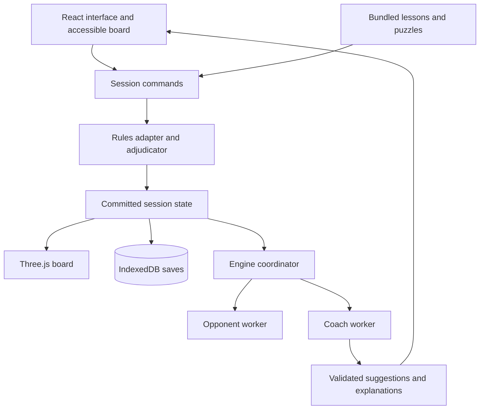

# Chess Workshop Product and Technical Specification

Version 1.1 — October 17, 2026

Chess Workshop is a local chess game that teaches a complete beginner through interactive lessons, guided practice, and real games on a fully rendered 3D board. The player can face a computer at several difficulty levels or share the same machine with another person. Optional coaching explains ideas and draws recommended moves on the board. Games and lessons resume where the learner stopped.

The proposed implementation is a browser application using React, TypeScript, Three.js through React Three Fiber, chess.js for legal moves, Stockfish compiled to WebAssembly for local analysis, and IndexedDB for saves. All gameplay, teaching, analysis, and storage run on the user's machine. The complete first release includes every core experience requested; the milestones below sequence its construction.

## Product goals and scope

The central learning loop is **learn an idea → practice it → use it in a game → review a mistake → try again**. Success means the learner understands a move's purpose and can eventually play with less assistance.

### Required experiences

| ID | Requirement | Observable outcome |
| --- | --- | --- |
| R1 | Real 3D chess | Board and pieces are 3D geometry with lighting, depth, camera orbit, zoom, and move animations. |
| R2 | Computer opponents | Choose among six difficulty presets and play either color. |
| R3 | Coaching during games | Request the strongest move found, see up to three candidate arrows, and read a supported explanation. |
| R4 | Local two player chess | Two people alternate using the same mouse and keyboard. Coaching, recommended-move arrows, and explanations can each be enabled for White only, Black only, both sides, or neither side. |
| R5 | Interactive lessons | Read short explanations, watch examples, make moves, receive feedback, and retry. |
| R6 | Save and resume | Recover ongoing games and exact lesson steps after closing and reopening the app. |
| R7 | Local operation | Play, learn, analyze, save, and restore without an internet connection after installation. |
| R8 | Practice and review | Practice selected positions and replay important mistakes from completed games. |

Desktop Windows with current stable Chrome and Edge is the primary target. Firefox receives a compatibility pass. Smaller screens should remain usable, but phones and native mobile applications are outside the first release.

“Shared controller” means one shared mouse and keyboard in release one. Touch uses the same select and destination actions where available. Physical gamepad support is an extension with a square cursor, select, cancel, and camera controls.

There are no accounts, subscriptions, advertisements, remote opponents, cloud saves, or required external AI services. A desktop executable may wrap the same application later; the browser version is the initial delivery.

## Lessons from comparable chess products

These observations inform the proposed features below. Interface design, lesson wording, artwork, and exercise explanations will be original.

| Product and observed feature | Application to Chess Workshop |
| --- | --- |
| [Lichess features](https://lichess.org/features) include basics, puzzles, persistent studies, analysis, and PGN import and export. | Connect lessons, practice, games, and review around one board and one local library. |
| [Lichess Practice](https://lichess.org/practice) groups exercises into checkmates, tactics, and endgames. | Organize practice by a named skill and a clear objective. |
| [Lichess Learn from Your Mistakes](https://lichess.org/@/lichess/blog/learn-from-your-mistakes/WFvLpiQA) asks the player to find an improvement before revealing it. | Offer a retry position before displaying the solution in game review. |
| [Chess.com Play Coach](https://support.chess.com/en/articles/10877257-how-do-i-play-against-the-coach) offers hints, takebacks, suggested arrows, threats, and move feedback. | Provide independent switches for legal moves, hints, recommendation arrows, threats, and evaluation. |
| [Chess.com Game Review](https://support.chess.com/en/articles/8584089-how-does-game-review-work) combines key moments, explanations, variations, and retries. | Prioritize a few teachable moments and link each to relevant practice. |
| [Fritz Online](https://account.chessbase.com/en/apps/fritz) provides assisted play, calculation training, and playing out positions. | Add a separate “Try a line” board state and practice against the computer from lesson positions. |
| [Chess Ultra](https://store.steampowered.com/app/518060/Chess_Ultra/) combines 3D environments, multiple AI levels, local multiplayer, tutorials, puzzles, and PGN export. | Deliver the physical board feel while keeping pieces, legal destinations, and teaching overlays readable. |

## Screens and primary journeys

### Home

Show Continue game and Continue lesson prominently, followed by Play computer, Play a friend, Lessons, Practice, Review, and Saved games. Display a short suggested practice activity based on completed lessons and recorded mistakes. Every recommendation must work from bundled content and local history.

First launch offers “Start from zero” and “I know the moves.” The first enters board orientation and movement lessons; the second opens a short optional placement exercise. All lessons remain browsable. Default settings are untimed play, White pieces, Beginner opponent, and coached assistance.

### Game setup

Computer setup selects color, difficulty, assistance preset, and optional clock. Local two player setup selects player names, assistance for each side, clock, and board orientation behavior. Both players see a summary of enabled help before starting.

Use untimed play by default. Optional controls are 10 minutes, 15 minutes plus 10 seconds per move, and custom minutes plus increment. Training games pause when hidden, suspended, or explicitly paused; reopening always presents Resume before any clock runs. This is a local training policy.

### Playing a game

The board occupies most of the window. A side panel shows whose turn it is, coach feedback, a scrollable move list, and game controls. An optional evaluation bar sits beside the board. Status text distinguishes Your turn, Computer thinking, Paused, Reviewing an earlier move, and Game finished.

Select a piece and then a destination, or drag it. Selection shows legal destinations if enabled. Illegal input leaves the position unchanged and gives a brief reason where known. A promotion chooser offers queen, rook, bishop, and knight before committing the move. Both selection and cancellation work with a keyboard.

Controls include Hint, Show best moves, Explain, Try a line, Undo, Save, Pause, Flip board, and Settings. Resign and draw actions are available in a secondary menu. Leaving a game first commits its latest state to storage.

Clicking an earlier move enters read-only history. A Return to live position control restores play. “Practice from here” creates a separate session; it never replaces the original game. Analysis variations are explicitly separate from committed moves.

After a result, offer Review, Retry a key moment, Save, Rematch, and Home. Rematch swaps colors by default while preserving the chosen difficulty and help settings.

### Local two player behavior

One shared input device controls whichever side has the move. Board orientation can remain fixed or rotate after each turn. When rotation is enabled, a turn handoff overlay and Continue button prevent accidental moves during the transition. Reduced motion switches to an immediate flip.

Coaching, recommended-move arrows, and explanations are fully available in local two player games. Setup offers four assistance configurations: White only, Black only, Both sides, and Neither side. Helping one player never requires enabling help for the other.

Each side has independent controls for coaching hints, recommended-move arrows, and explanations, with Off, On request, or Automatic behavior for each feature. For example, White can receive automatic arrows and explanations while Black plays without help; both players can instead request coaching on their own turns. Changing one feature or side does not change the others. Save and restore these settings with the game.

Both players can see that assistance is active; the shared screen cannot provide private advice. During a turn, suggestions use the current side's settings. Clear the previous side's arrows and coaching before handing over, then show help only if enabled for the next side. A setting change takes effect after an on-screen acknowledgment by both players using the shared controls.

Undo requests acknowledgment from the other player and reverses one ply, meaning one player's move. Computer training undo returns to the learner's previous decision point, reversing the computer reply too if it already happened. Cancel outstanding engine work before either operation. Preserve the earlier continuation as a review branch or snapshot.

### Saved games and lessons

Show saved sessions with name, mode, date, side to move, result, difficulty, and a small board preview. Separate ongoing sessions from completed games. Support rename, duplicate, resume, export, import, and delete with confirmation. Home resumes the most recently active session; the library keeps multiple sessions.

## Coaching and recommended moves

### Assistance presets

| Preset | Legal destinations | Hints and arrows | Feedback |
| --- | --- | --- | --- |
| Guided | Visible | Automatic best candidate on the learner's turn; alternatives on demand | Brief explanation after each move; optional mistake warning |
| Coached | Visible | On request | Important mistakes and requested explanations |
| Independent | Optional | Off until requested | Summary after the game |

Every component can be changed individually. Computer play defaults to Coached; two player play defaults to Off for both sides. In two player games, apply presets separately to White and Black and allow independent overrides for coaching, arrows, and explanations. Lessons control their own hints so answers are not revealed before an attempt. Assisted games and exercise attempts record help use separately from independent results.

Hints reveal progressively: identify the idea, highlight a useful piece, then show the exact move and continuation. The initial idea might be “Look for an undefended piece.” Revealing the exact answer does not count as an independent solve.

### Board overlays

- Small dots mark legal empty destinations; rings mark legal captures.
- A solid numbered arrow identifies the strongest candidate found. Two thinner numbered arrows can show alternatives. A matching text list gives notation and explanation.
- Threat arrows use a distinct dashed style and explicit labels. A threat overlay describes a specific legal continuation; an attacked square alone does not prove a piece will be lost.
- Selected squares, the last move, check, lesson targets, and arrows have separate styles. Shape, labels, and line style supplement color.
- Arrows remain attached to logical squares during camera motion and board flips. Knight arrows may bend for readability. Promotion candidates include the promoted piece in the label.
- All recommendations disappear immediately when their position becomes obsolete. Hide them during transitions, opponent turns without enabled help, and finished positions.

“Best move” means the strongest move found within the current local search budget. Display “Analyzing” while results are provisional and provide More analysis on demand. Equivalent moves can be good answers; do not promise a unique perfect move or a guaranteed win.

### Explanations that the application can support

Stockfish supplies moves and evaluations, not a complete natural-language teacher. Release one combines authored lesson text with deterministic position checks and validated engine continuations. It requires no language model.

Initial explanation patterns cover check and mate, immediate material changes, legal attacks on pieces, forks, absolute pins, development, castling, and promotion. Distinguish direct observations from tactical conclusions. A “wins a piece” explanation requires a verified continuation or an authored solution; counting attackers and defenders is insufficient.

Each message names the move, states one useful idea, and offers a short example when available. An original opening example is: “Nf3 develops your knight and attacks e5. It also clears g1 for castling.” Only show it when those facts hold. If no explanation pattern is supported, say “This is the strongest continuation found. Explore the line to see the replies.”

Optional mistake protection pauses a proposed move with a supported warning and Play anyway or Try another move. It must not silently change the move. Routine feedback is nonblocking, especially in timed games.

Use evaluations from a consistent perspective: numerical scores in the analysis panel always favor White when positive, while prose names the favored side. Mate scores remain separate from numerical advantage. Engine evaluations are estimates rather than a count of material or a personal win probability. The [Stockfish FAQ](https://official-stockfish.github.io/docs/stockfish-wiki/Stockfish-FAQ.html) explains these interpretation limits and its strength controls.

### Game review

Analyze locally in a cancellable background queue. Show progress and allow review of already analyzed moves. Select at most five important moments for a short first review, prioritizing missed mates, hanging pieces, and large changes in advantage. Review can expand to every move.

For a moment, show what happened, the better continuation, and a Retry button that initially hides the answer. When the player's move is missing from the top candidates, analyze that move explicitly before comparing it. Compare searches with compatible settings and normalize the side-to-move sign before calculating any loss. Handle mate transitions separately; do not invent centipawn values for mate.

Begin with “missed opportunity” and “costly move” labels whose thresholds are configurable and verified against curated examples. Avoid a supposedly universal accuracy score. Convert a supported tactical error into a practice card linked to its original game and skill.

## Computer opponents and local analysis

### Proposed difficulty presets

The values below are initial tuning settings, not measured human ratings. Validate them in playtesting. Exact supported engine options and ranges come from the installed engine's startup handshake.

| Preset | Proposed move policy | Initial search budget |
| --- | --- | --- |
| First steps | Custom teaching opponent using legal moves and simple material, development, and king safety heuristics; occasionally selects a weaker legal move | At most 250 ms |
| Beginner | Same policy with fewer deliberate errors and one opponent reply considered | At most 500 ms |
| Casual | Stockfish skill 2, strength limit disabled | 500 ms |
| Developing | Stockfish skill 6, strength limit disabled | 750 ms |
| Challenging | Stockfish skill 12, strength limit disabled | 1,000 ms |
| Strong | Stockfish skill 20, strength limit disabled | 2,000 ms |

The custom teaching policy is necessary because a reduced-strength engine may still punish a new learner too strongly. Its legal move selector scores all moves, samples among plausible moves using a seeded random generator, and uses level-specific error probabilities. Store the seed and policy version with the session. Calibrate the probabilities with beginner playtests and reproducible opponent games. It must never fabricate illegal moves, remove pieces, or change the rules to help the player.

The coach always uses the strongest available settings independently of opponent difficulty. Changing the opponent level affects future opponent decisions and is recorded in game metadata. It never weakens lesson validation or coaching.

### Engine choice

Bundle a pinned Stockfish.js WebAssembly build and its matching assets. Start with the lite single-threaded build; retain an adapter that permits a larger engine later. The [Stockfish.js project](https://github.com/nmrugg/stockfish.js) documents browser workers, lite and full builds, and matching JavaScript and WASM files. Single-threaded builds avoid the cross-origin isolation requirements of its threaded builds. If a threaded upgrade is added, configure the documented isolation headers and detect support before selecting it.

Load engine files from the local application bundle, never a CDN. Verify the actual bundled build's startup, supported instructions, option ranges, file paths, and memory use in the first engineering milestone. An engine failure must show Retry while leaving the game save and local two player mode available.

### Engine adapter and scheduling

Use separate worker instances for opponent play and coaching, loading them lazily. Run at most one heavy search at a time by default: opponent decisions first, requested hints next, background review last. The second worker prevents option settings for a weak opponent from contaminating the coach.

The adapter uses the [Stockfish UCI protocol](https://official-stockfish.github.io/docs/stockfish-wiki/UCI-Protocol-and-Stockfish-Commands.html): initialize with `uci`, discover options, await `uciok`, configure while idle, then check `isready` and `readyok`. Supply the initial position and full move history. Use `MultiPV` for up to three candidate lines. `UCI_LimitStrength` enables `UCI_Elo`; it overrides `Skill Level`. Any optional rating control must respect the reported range rather than inventing low Elo values.

Associate every application request with session ID, position revision, purpose, engine generation, and settings. Raw UCI messages carry no application request ID. Allow only one outstanding search per worker. On cancellation, send `stop` and drain that search through its final `bestmove` before starting another. A readiness response alone does not establish that a prior search has ended. Terminate and recreate an unresponsive worker after a bounded timeout. Discard output from obsolete generations and revisions.

Parse candidate moves into a fresh rules state and reject illegal output before rendering or committing it. Normalize evaluations at the boundary. Publish alternatives from a coherent completed search iteration where possible; do not mix unrelated search states. Cache by initial position, relevant history, engine version, settings, and search budget. The same piece placement can have different draw context.

Default coaching search is about one second with up to three candidates; More analysis adds up to five seconds. Background review uses a configurable per-position budget and yields to active play. Stop searches on pause or navigation and clear their overlays immediately. Turn off continuous pondering in the initial release.

## Chess rules and adjudication

Use standard chess. The [FIDE Laws of Chess](https://handbook.fide.com/chapter/E012023) are the rules reference; this application adapts physical procedures to local training.

| Area | Required behavior |
| --- | --- |
| Legal play | White starts. Enforce movement, captures, turns, king safety, and checkmate. Kings are never captured. |
| Castling | Track rights; validate clear paths and the king's start, crossing, and destination squares. |
| En passant | Allow only immediately after the qualifying pawn advance; verify king safety. |
| Promotion | Offer all four legal pieces, including underpromotion. |
| Draws | Detect stalemate and supported dead positions; support agreement. Threefold repetition and 50 moves per side without pawn movement or capture permit a claim. Fivefold repetition and 75 moves per side automatically end play; checkmate on the final move takes precedence. |

Repetition keys include side to move, piece placement, castling rights, and legally relevant en passant availability. Provide Claim draw for an eligible current position and a claim-with-intended-move flow. At those decision points the computer claims an available draw deterministically. No touch-move penalties or arbiter procedures are simulated.

chess.js handles move generation, validation, SAN notation, FEN positions, and basic game state. Its aggregate game-over and draw helpers do not encode the entire claim policy above; the application needs a separate adjudicator. Consult the [chess.js API](https://jhlywa.github.io/chess.js/) and test the pinned version's behavior.

Known first-release boundary: automatic dead-position recognition covers proven material patterns, including bare kings and king with one bishop or knight against a bare king. It does not claim to solve arbitrary blocked dead positions. Offer agreed draws and explain this limit in Help. Do not incorrectly draw every two-knight position or every position without a forced mate. Timed games need a separate check for whether the nonflagging side can possibly mate; unusual unresolved positions require a visible adjudication choice rather than a fabricated definitive result. Formal tournament certification is outside scope.

## Teaching curriculum and exercise design

### Learning method

Teach one idea at a time with a short explanation, an animated worked example, an action on the board, specific feedback, and a later independent retry. Alternate demonstrations with solving, combine graphics and words, and revisit earlier material. These choices draw on the general learning recommendations in the [IES practice guide](https://ies.ed.gov/ncee/wwc/PracticeGuide/1); they are a proposed application to chess rather than evidence for a particular chess improvement rate.

Lessons target five to ten minutes. Each contains one demonstration and three to five playable exercises. Show plain-language square names and notation together until the learner is comfortable. Explain vocabulary on demand. Do not require memorizing openings before learning safety, development, and king protection.

### First release curriculum

| Module | Lessons | Practice goal |
| --- | --- | --- |
| Board and movement | Board orientation and coordinates; rook; bishop; queen; knight; king; pawn | Identify squares and move each piece through constrained tasks. |
| Safe legal play | Captures and blockers; attacked and defended squares; check and responses; checkmate versus stalemate | Make legal decisions and distinguish threats from game results. |
| Special moves | Castling; en passant; promotion and underpromotion | Execute and explain each move in contrasting examples. |
| Playing a full game | Turn sequence and notation; piece values and trades; a checks, captures, threats routine; first guided game | Complete a game and use a consistent decision routine. |
| Opening foundations | Center and development; king safety; repeated moves and early queen risks | Play sensible opening moves and explain their purpose. |
| Tactical foundations | Hanging pieces; forks; pins; skewers; discovered attacks; removing a defender | Recognize a motif and calculate a short sequence. |
| Finishing games | Mate in one and back rank; ladder mate; king and queen mate; king and rook mate; pawn races and opposition | Convert simple advantages while avoiding stalemate. |

This defines 32 lessons and at least 96 interactive exercises, plus their demonstrations. Every module is part of the complete first release. A smaller set may be used during development, but it is not the final content target.

Later modules can add deeper opening plans, positional play, more tactical motifs, rook endgames, and annotated historical games. Keep optional challenge content separate from the beginner path.

### Lesson behavior and grading

Lesson states are Introduction, Demonstration, Attempt, Feedback, Retry, and Complete. Save the current state, exercise position, move sequence, attempt count, hints revealed, and demonstration step. Closing during feedback returns to that feedback; closing during a move animation returns to its last committed logical state.

Validate the educational objective, not merely equality with one stored engine move. Accept any legal mate in a mate-in-one exercise. Movement tasks use reachable targets; tactical tasks use authored accepted branches or a validated outcome predicate. A puzzle with an intended unique move must be checked for alternatives during content review.

Wrong legal moves get feedback explaining the relevant consequence and a retry. Illegal moves do not advance the exercise. For multi-move tasks, reply from an authored legal branch or an explicitly constrained engine policy. Specify the response to unexpected moves; never silently substitute an unrelated position.

Track Completed separately from Practiced independently. Mark a skill Practiced independently after at least three independent successes across two sessions, including a later review. Initial review intervals are 1, 3, 7, and 14 days, an adjustable product heuristic. A reveal or failed retry schedules an earlier revisit. No claimed rating gain follows from completion.

### Example exercise

An original knight-fork task starts from `8/4k3/5q2/8/8/2N5/8/4K3 w - - 0 1`. Ask the learner to find a knight move that checks the king and attacks the queen. The accepted move is `c3d5`, displayed as `Nd5+` after validation. The explanation is “Your knight checks the king on e7 and attacks the queen on f6. Black must answer the check.” The hint sequence identifies a double attack, highlights c3, then reveals d5. The exercise ends after the fork; winning the queen is not asserted without checking the reply sequence.

### Content records and quality

Each lesson and exercise has a stable ID, content version, module, prerequisites, objective, starting FEN, learner side, accepted moves or objective predicate, legal reply branches, explanations, staged hints, overlay instructions, and source or author credit. Constrained movement demonstrations may use partial boards in a separate sandbox; do not pass invalid teaching setups into normal game or engine mode.

Automated content validation replays every authored branch, verifies the learner side and objective, and checks referenced squares and notation. Human review checks instructional accuracy, readable arrows, accepted alternatives, and clear feedback. Version content so an update does not erase existing progress; migrate an active lesson or retain its compatible content version.

Practice includes movement drills, a topic-filtered puzzle collection, checkmate drills, and play against the computer from a lesson or game position. Initially curate 100 additional puzzles, bundled locally. The [Lichess open database](https://database.lichess.org/#puzzles) is an available CC0 source with themes and solution moves. Its puzzle FEN precedes the opponent's setup move: apply the first recorded move before presenting the puzzle, and start the learner solution with the second. Record original IDs and attribution, and write original instructional explanations.

## 3D board and interaction design

### Rendering approach

[Three.js WebGLRenderer](https://threejs.org/docs/pages/WebGLRenderer) renders through WebGL 2. [React Three Fiber](https://r3f.docs.pmnd.rs/getting-started/introduction) integrates Three.js with React; its stable React and Fiber major versions must match. Use stable compatible packages and pin the tested versions in the lockfile. Avoid an alpha renderer as a launch dependency.

Construct an actual board mesh, 64 logical square surfaces, and 32 independently positioned piece objects. Use procedural Staunton-inspired geometry for the initial implementation or locally bundled, appropriately licensed GLB assets. [GLTFLoader](https://threejs.org/docs/pages/GLTFLoader.html) supports glTF 2.0 assets. Share geometry and materials where possible, but keep each physical piece independently addressable.

Use soft lighting, restrained shadows, a clear difference between the two armies, and an uncluttered tabletop. Label files and ranks. Ship a classic wood theme and a high-contrast theme. Decorative rooms and additional sets are later additions.

Provide a perspective play view, an overhead view, and an accessible flat board. The main experience remains genuinely 3D. The flat board is a separate representation of the same game state and works when WebGL 2 is unavailable or the user prefers it.

### Picking and camera

Use [raycasting](https://threejs.org/docs/pages/Raycaster.html) or Fiber pointer events to map input to squares and pieces. All renderers call the same move command. Disable camera dragging during a piece drag and use a movement threshold to distinguish clicks from orbit gestures. Camera movement never commits a chess move.

Constrain orbit so the camera cannot go under the table or lose the board. Include reset view, zoom limits, flip, and an overhead preset. [Drei controls](https://drei.docs.pmnd.rs/controls/introduction) provide camera controls compatible with demand rendering. Overlays use a separate rendering layer with depth behavior that keeps them visible without hiding piece silhouettes. Overlays do not intercept board input.

### Animation and accessibility

Animate ordinary moves, captures, castling, en passant, and promotion from a committed move event. The rules state is authoritative; mesh positions never determine legality. While an animation runs, block a second move and retain the correct save state. Reduced motion makes transitions immediate.

Maintain an accessible DOM board with square labels, keyboard focus, move entry, move history, and status announcements. Arrow keys navigate squares, Enter selects or commits, and Escape cancels. Shortcuts do not fire while typing in a field. Provide a text equivalent for every recommendation, zoomable text, clear focus, independent sound controls, and no required audio.

## Saving and restoring local state

### Storage strategy

Use IndexedDB for sessions, lesson progress, settings, and analysis records. It provides asynchronous structured storage and transactions, as described in the [IndexedDB documentation](https://developer.mozilla.org/en-US/docs/Web/API/IndexedDB_API). Small display preferences may use localStorage; the active game must not depend on it.

Save automatically after every committed move, lesson transition, assistance change, pause, and explicit Save action. Serialize writes per session and acknowledge Saved only when the transaction completes. Keep a monotonically increasing revision and a previous valid snapshot. Pending save status remains visible; storage failure offers Retry and Export without discarding the in-memory session.

While a clock runs, checkpoint its elapsed time once per second and on visibility changes. Normal navigation pauses and saves before leaving. Unexpected termination restores the last committed checkpoint; do not depend on an asynchronous unload handler to finish a save. Apply increment exactly once in the same session transition as its move.

Browser storage is tied to its origin and profile. Ship a launcher with a fixed localhost host and port; if occupied, show an actionable error rather than silently switching origins. Request persistent storage where supported, and provide portable backups. Browser data can still disappear when the user clears it; private browsing may discard it on close. These constraints follow the [browser storage lifecycle](https://developer.mozilla.org/en-US/docs/Web/API/Storage_API/Storage_quotas_and_eviction_criteria).

### Saved session records

| Record | Required fields |
| --- | --- |
| Session identity | Schema version, ID, title, mode, creation and modification timestamps, revision, app and content versions |
| Game | Initial FEN, committed UCI moves, derived current FEN for validation, selected history ply, result and reason, players and colors |
| Rules context | Rule profile, adjudication events, draw offers or claims, initial history availability |
| Opponent | Engine and policy versions, difficulty settings, changes, teaching-policy seed and random state |
| Clock | Time control, remaining time by side, active side, pause status, last committed clock snapshot |
| Teaching | Lesson and exercise IDs, step, state, attempt moves, hints, results, review due dates |
| Presentation | Camera preset, orientation, assistance by side, selected overlays, audio and accessibility preferences |
| Review | Variations, annotations, linked practice cards, analysis metadata and provenance |

Initial FEN plus committed moves is the authoritative game history. Rebuild and compare it with the stored current FEN during load. FEN alone does not preserve prior repetition occurrences, and a single-position import cannot recover unknown earlier moves. Mark that boundary visibly and count repetitions only from the known history.

Restore sessions paused. Recreate engine workers from the rebuilt position; do not serialize a running worker or replay an obsolete pending engine response. A committed computer move restores exactly once; a search interrupted before commitment is safely restarted when play resumes. Clocks freeze while the application is closed.

### Portable files and safe recovery

Export and import `.chessworkshop.json` for a full session and a versioned backup containing all sessions and learning progress. Export PGN for interoperable games and import standard mainline PGN and FEN. PGN exchange does not promise to preserve camera, clock, lesson, or all variation metadata. Report unsupported PGN features before import, and import into a new session.

Validate schema versions, file sizes, position structure, and every move before accepting a file. Render imported text as text. Initially cap session imports at 10 MB and full backups at 50 MB with clear errors; these are configurable product limits. A corrupt or unsupported file must not overwrite a working session.

Migrations run transactionally and keep a recoverable prior record. A future unsupported schema opens an explanation with export options. Multiple tabs use a single-writer lock for each session; other tabs open read-only or request an explicit takeover. Revision checks reject stale writes.

## Application architecture and local delivery

Keep the layers separate: the rules adapter validates moves; the adjudicator decides results; session commands coordinate transitions; the renderer displays state; the engine adapter proposes moves; the lesson runner grades objectives; the repository handles persistence. A worker result is never a direct mutation of the board.

Proposed source organization is `src/chess`, `src/sessions`, `src/engine`, `src/board`, `src/coaching`, `src/lessons`, `src/storage`, and `src/ui`, with versioned content under `content/` and bundled engine and model assets under `public/`. These are planned paths; no application source exists yet.

Use Vite for development and static production output. A local launcher serves the production bundle on a fixed loopback address and opens the browser. Binding is limited to loopback. The initial setup can download development dependencies; the installed runtime includes all required assets and needs no internet.

Optional installable PWA support caches a versioned complete runtime. Service workers work with localhost as a secure origin, as described in [MDN's service worker guide](https://developer.mozilla.org/en-US/docs/Web/API/Service_Worker_API/Using_Service_Workers). A packaged local server remains the baseline launch path, avoiding dependence on a service worker cache or opening the project with `file://`. Offer an update only between sessions or after saving; do not replace assets in the middle of a game.

Alternative assessment: plain Three.js offers the same rendering capability with more manual integration; [Babylon.js](https://www.babylonjs.com/specifications/) is a viable full 3D engine. React Three Fiber is the proposed choice because the rest of this app is UI and state intensive. This is an architectural preference, not a performance benchmark. Physics simulation is unnecessary for rule-based piece movement.

Use background workers so engine computation does not occupy the interface thread; see the [Web Workers guide](https://developer.mozilla.org/en-US/docs/Web/API/Web_Workers_API/Using_web_workers). Avoid remote fonts, model downloads, analytics, and required network calls at runtime. Bundle credits and licenses. Preserve the engine license and an exact source reference for the pinned build; Stockfish.js identifies its engine as GPLv3. Track model, sound, and content provenance in an asset manifest.

## Quality targets and acceptance checks

### Performance and resilience targets

These are proposed release targets to measure on the user's Windows machine, not existing benchmark results. Record the browser, CPU, GPU, memory, and selected quality settings when measuring.

| Measure | Initial target |
| --- | --- |
| 3D rendering | Aim for 60 FPS at 1080p; offer a reduced quality mode targeting at least 30 FPS |
| Input feedback | Selection and legal destination feedback within 100 ms at the 95th percentile |
| First interaction | Home and basic board usable within 3 seconds from local launch; engine may load afterward |
| Coaching | First useful candidate within 2 seconds at the 95th percentile with the default search budget |
| Save acknowledgment | Completed IndexedDB save within 500 ms at the 95th percentile under normal storage conditions |
| Stability | No lost acknowledged move after reload; no stale recommendation applied; no duplicate computer move |

Cap rendering resolution on dense screens, share assets, limit shadows, and render on demand when idle. Stop unnecessary work in hidden windows. If WebGL fails, preserve the session and offer the flat board. If the engine fails, preserve the session, show Retry, and keep lessons with authored answers and local two player play usable.

### Acceptance scenarios

| ID | Scenario | Pass condition |
| --- | --- | --- |
| A1 | Launch offline after installation | All core modes, bundled lessons, models, analysis, and save operations work with external network requests blocked. |
| A2 | Inspect the 3D board | Orbit exposes real piece and board geometry; overhead, reset, zoom, and flip remain usable. |
| A3 | Play each computer level as either color | Every move is legal, difficulty is recorded, and hints retain independent strength. |
| A4 | Change position while analysis runs | Undo, load, flip, history, restart, and navigation never apply obsolete results or duplicate a move. |
| A5 | Request coaching | Legal dots differ from recommendations; up to three labeled legal candidates and matching text appear for the correct side. |
| A6 | Share the machine | Both people move using one input device. Verify White only, Black only, Both sides, and Neither side assistance; independently toggle coaching, arrows, and explanations for each player. Turn handoff clears previous advice, respects the next player's settings, and preserves orientation and acknowledgment behavior. |
| A7 | Reopen a saved game | Initial position, full move history, turn, rights, clock, difficulty, help settings, and result reconstruct correctly. |
| A8 | Reopen a lesson | Return to the exact exercise, step, committed position, attempts, and hint stage. |
| A9 | Complete a learning module | Every authored branch is legal; accepted alternatives work; reveals do not count as independent solves. |
| A10 | Exercise special moves | Test both colors, both castling sides, expired en passant, king exposure, promotion captures, and underpromotion. |
| A11 | Exercise game results | Checkmate, stalemate, supported dead positions, resignation, agreements, current and intended-move claims, and automatic draws produce the correct reason. |
| A12 | Restore before a draw claim | Repetition history and move counters survive save, undo, branching, export, and import. |
| A13 | Use keyboard and flat board | Complete a game and a lesson without dragging or relying on color, sound, or the WebGL canvas alone. |
| A14 | Interrupt persistence | Quota failure, corrupt imports, migration failure, and competing tabs show recovery paths without overwriting valid state. |
| A15 | Review a mistake | A supported moment opens as a separate retry with the answer hidden; returning preserves the original game. |
| A16 | Inspect the complete learning library | All 32 lessons, at least 96 lesson exercises, and 100 additional curated puzzles are available offline. |

Use focused rules and content tests, engine integration tests with the actual bundled WASM, and browser journeys for saves and interaction. Include perft regression positions for the rules adapter, evaluation sign checks for both colors, cancellation races, history reconstruction, and clock pause and resume. Visually inspect 3D overlays from both orientations, at low quality, with reduced motion, and at 200 percent text zoom. Automated checks supplement actual beginner playtesting.

## Implementation milestones

1. **Prove local foundations.** Scaffold the app, pin compatible packages, load the selected engine offline, validate worker cancellation, create the 3D board, and prove a transactional save and resume. Exit with a measured prototype and resolved asset loading issues.
2. **Complete playable chess.** Add legal input, special moves, adjudication policy, computer presets, local two player mode, clocks, game history, multiple saves, and portable imports and exports. Exit with a resumable game in both play modes.
3. **Add coaching and review.** Implement assistance presets, candidate and threat overlays, progressive hints, validated explanations, independent coach settings, variations, and retry review. Exit with supported guidance for both colors and no stale worker results.
4. **Build the teaching workshop.** Implement the lesson runner, all first-release curriculum content, curated practice puzzles, mastery records, review scheduling, and exact lesson continuation. Exit with every lesson and exercise validated and reviewed.
5. **Verify the complete local release.** Finish keyboard access, flat-board fallback, performance tuning, backup recovery, packaging, credits, and all acceptance scenarios. Exit with an offline installation and a user guide for launching, saving, restoring, and backing up.

After the complete first release, consider gamepad navigation, an optional desktop wrapper, more board sets, deeper endgames, historical-game challenges, and expanded lesson authoring. Online matchmaking, cloud synchronization, and remote teaching services would require a separate scope decision.

## First playable demonstration

A learner launches Chess Workshop offline, completes a knight movement lesson, and starts a game against Beginner. They request a hint, reveal a recommended arrow, and read its purpose. After several moves they close the browser, return to the same game, and finish it. They retry a missed tactical opportunity in review, then start a local game with a friend using the same mouse. Both players can enable or disable help. This journey is the minimum integrated demonstration of the intended product.
